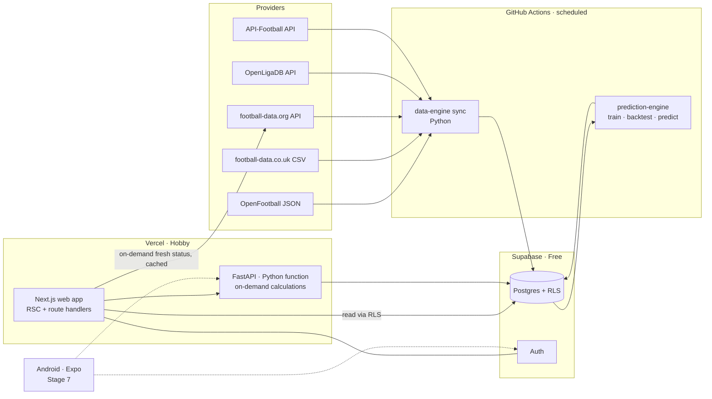

# AIDICT — Technical Architecture

**Status:** Proposed (Phase 0) · **Date:** 2026-11-26
Free-tier limits were verified on 2026-11-26 from official pages (see §7). Versions are the latest published on npm/PyPI on that date. They are pinned when Stage 3 starts.

---

## 1. Guiding decisions

1. **Precompute, then serve.** Predictions are calculated in scheduled batch jobs and stored as immutable snapshots. The web app reads them. Nothing on the request path trains a model, and no permanent background process exists.
2. **Python owns data and models. TypeScript owns the product.** Provider adapters, normalisation, the modelling pipeline and backtesting are in Python, one language for all data work. The web app and the future Android app are TypeScript.
3. **Postgres is the contract.** Supabase Postgres, with RLS, is the single source of truth between the batch pipeline, the API and the clients.
4. **Every number is traceable.** Each displayed probability links to `model_version`, `input_hash`, `snapshot_at` and the provider records it was built from.
5. **Free tier first, with a clear upgrade path.** Each component has a documented ceiling and the next step if that ceiling is reached.

---

## 2. System overview



---

## 3. Components

### 3.1 Web application: `apps/web`
| Concern | Choice | Notes |
|---|---|---|
| Framework | **Next.js 16** (App Router, React 19, Server Components) | Route handlers keep provider keys server-side |
| Language | TypeScript (strict) | Pinned to the TS version Next.js officially supports at Stage 3. TS 7.0 (native port) is new, so verify compatibility first |
| Styling | **Tailwind CSS v4** + CSS-variable design tokens | Tokens are shared with the prototype (`prototype/src/styles/tokens.css`) |
| Components | **shadcn/ui** pattern (Radix primitives, code owned in-repo) restyled with AIDICT tokens | No template look. Components are copied in and reworked |
| Server state | **TanStack Query v5** | Client-side polling for the Live view only |
| Client state | **Zustand v5** | Multi-match selection, UI preferences |
| Charts | **Recharts 3** | Reliability diagrams, trends, comparisons. Score-matrix heatmap is custom SVG |
| Icons | Lucide | Used only where they add meaning |
| Auth | **Supabase Auth** via `@supabase/ssr` | Cookie sessions, protected route groups, admin role in `app_metadata.role` |
| Validation | **Zod** (`packages/validation`) | Shared by forms, route handlers and API client |
| Testing | Vitest (unit), Playwright (E2E) | Playwright can drive the system Edge browser (`channel: 'msedge'`), so no browser download is needed |

### 3.2 Prediction and data API: `services/api` (FastAPI)
- Deployed as a **Vercel Python Function** (Python 3.12+, FastAPI preset; 300 s max duration, 2 GB on Hobby).
- Serves on-demand calculations that are cheap and deterministic from stored parameters:
  - derive any supported market from a stored score matrix,
  - multi-match analysis (Monte Carlo over stored marginals),
  - "what-if" exploration (adjusted λ, clearly labelled as user exploration, never stored as a prediction).
- Verifies Supabase JWTs. Uses a read-mostly DB role. Never trains models.
- Gives the Android app (Stage 7) one shared HTTP API.

### 3.3 Data engine: `services/data-engine` (Python)
```
services/data-engine/
  providers/
    base.py            # ProviderAdapter protocol + UNSUPPORTED result type
    openfootball/      # JSON import (history)
    football_data_uk/  # CSV import (history, stats, odds)
    football_data/     # football-data.org v4
    openligadb/        # OpenLigaDB
    api_football/      # API-Football v3 (budget-capped)
  normalise/           # team/competition aliasing, time zones, statuses
  merge/               # fixture matching, conflict detection, reliability weights
  badges/              # crest resolver: provider crest → secondary → fallback; validate, sanitise SVG, mirror, thumbnails
  notify/              # emits notification_events (dedupe keys) and sends Web Push
  quality/             # freshness, completeness, data_quality_reports
  budget/              # per-provider quota manager + circuit breaker
  jobs/                # sync_history, sync_current, sync_live_window, settle_results
```
**Common adapter interface.** Every method returns `Ok(data) | Unsupported(reason) | Failed(error)`:

`get_competitions · get_seasons · get_fixtures · get_fixture_by_id · get_results · get_standings · get_teams · get_team_statistics · get_match_statistics · get_live_matches`

**Merge rules (summary):**
- Fixture identity: `(competition, season, normalised home, normalised away, kickoff date ±36 h)` → one internal `fixture_id`. Provider IDs are kept in `provider_mappings`.
- Times are stored as UTC `timestamptz` and the source time zone is recorded. Statuses map to one internal enum: `SCHEDULED · TIMED · LIVE · HT · FT · AET · PEN · POSTPONED · SUSPENDED · CANCELLED · AWARDED`.
- Score conflicts open a `data_conflicts` row. The higher-reliability source wins only when it is `FINAL` and fresher. Otherwise the record is flagged and excluded from training until resolved.
- Statistics from different providers are stored with a `definition_source` and are **never mixed in one feature** unless the definitions are validated as equivalent.

### 3.4 Prediction engine: `services/prediction-engine` + `ml/`
Python 3.12 · NumPy · pandas · SciPy · scikit-learn · statsmodels · LightGBM/XGBoost (only if they beat the simpler models out-of-sample).

| Model | Purpose |
|---|---|
| Elo (home advantage, competition K-factor, goal-difference multiplier, season regression) | Team strength over time and a core feature |
| Poisson (time-decayed attack/defence GLM) | Score distribution baseline |
| **Dixon–Coles** (τ low-score correction, ξ time decay) | Primary score-matrix model. All goal markets derive from its matrix |
| Multinomial logistic regression | 1X2 from features (Elo diff, form, rest, shots-based ratings) |
| LightGBM / XGBoost | Evaluated challengers. Promoted only on better log loss **and** calibration |
| Monte Carlo | Multi-match analysis, season and table simulation. Single-match markets use exact matrix sums |
| Calibration layer | Isotonic or Platt per market, fitted on walk-forward out-of-fold predictions only |

**Smart Market Predictions (24 markets).** Market models are plug-in modules (`ml/football/markets/<market>.py`) that consume shared base models: the score matrix, a goal-order model (time-varying, score-state-dependent goal intensities), a negative-binomial corners model and a player model. Each module declares its required data and settlement rules and has its own backtest and gate. A selection step ranks eligible outcomes and removes correlated ones, using the exact joint distribution from the score matrix and goal sequences, then stores the strongest 4–5 per match as immutable `smart_picks`. Full design: `PREDICTION_ENGINE.md`.

**Validation:** chronological splits, walk-forward by matchweek, and features built strictly from data timestamped before `prediction_time`. Metrics: Brier, log loss, **RPS** (ordered 1X2), ECE, reliability diagrams, bootstrap 95% CIs, sample sizes. Baselines: base rate, Elo-only, and **market-implied probabilities from closing odds** (margin removed), where available.

**Market activation gate**, applied per (sport, competition group, market):
1. ≥ 300 out-of-sample settled predictions in walk-forward evaluation,
2. log loss better than the base-rate baseline with the 95% CI excluding zero difference,
3. ECE ≤ 0.04 (1X2 and other multi-outcome markets) / ≤ 0.03 (binary markets),
4. input completeness ≥ 90% for required features.

Markets that fail stay **Validating** or **Disabled** and are shown that way. HT result and HT/FT need a separate half-time goal model and stay gated until validated.

### 3.5 Scheduling (no permanent processes)
| Job | Runner | Schedule | Est. billed minutes/month |
|---|---|---|---|
| `sync_current` (fixtures, results, standings) | GitHub Actions | hourly | ~720 |
| `predict_upcoming` (snapshot predictions T-24h and T-2h) | GitHub Actions | 4× daily | ~240 |
| `settle_results` + performance refresh | GitHub Actions | 2× daily | ~60 |
| `retrain_and_backtest` | GitHub Actions | weekly (Mon 04:00 UTC) | ~120 |
| `sync_history` (OpenFootball, football-data.co.uk) | GitHub Actions | weekly / manual | ~20 |
| **Live status refresh** | Next.js route handler, on demand | when Live is open, cached 60 s in DB, throttled to the provider budget | 0 (Vercel) |

GitHub Free includes **US$12/month** of Actions compute for private repos (~2,000 Linux minutes at $0.006/min). The plan above uses ~1,160. A **public** repo is free and unlimited for standard runners, but the code would be public. Recommendation: a **private repo**, since secrets are in GitHub Secrets either way. The scheduled jobs also keep Supabase active, which prevents the 7-day inactivity pause.

Vercel Hobby crons are limited to **once per day** with ±59 min precision, so they are not used for data sync.

---

## 4. Security model
- **Secrets:** provider keys and the Supabase service-role key exist only in GitHub Secrets (batch) and Vercel server env (API and route handlers). The client gets only the Supabase URL and anon key.
- **RLS on every table.** Public sports data is read-only to `authenticated`. User tables are owner-only. Admin and pipeline tables are restricted to `role = 'admin'` or the service role.
- **Immutable predictions:** `prediction_snapshots` has no UPDATE/DELETE grants, and a trigger rejects writes after `snapshot_at`. Outcomes are recorded in a separate table.
- **Admin:** `/admin` route group, server-side role check, audit log on every admin action. Keys are shown masked (`••••a3f2`).
- **Inputs:** Zod on all inputs. Parameterised queries only. Provider responses are validated with Pydantic before persistence.
- **Rate limiting:** per-user limits on route handlers (a Postgres-backed token bucket) and on-demand provider refresh behind a global budget.
- **Headers:** CSP, HSTS, `frame-ancestors 'none'`, Referrer-Policy. Dependency audit in CI.

---

## 5. Monorepo layout (npm workspaces + Python services)
```
aidict/
├── apps/web/                    # Next.js (Stage 3)
├── prototype/                   # UI prototype (Stage 2, sample data only)
├── services/{api,data-engine,prediction-engine}/
├── packages/{shared-types,api-client,validation,shared-utils}/
├── ml/{football,basketball,tennis,cricket,baseball,hockey,calibration,backtesting}/
├── supabase/{migrations,seed}/
├── tests/  infrastructure/  documentation/
├── .github/workflows/           # scheduled jobs + CI
├── .env.example  README.md  package.json
```
npm workspaces are used because npm 11 is installed and pnpm is not. Turborepo can be added later if build times justify it.

---

## 6. Multi-sport extensibility
- `sports` and `prediction_markets` are data, not code. A sport module registers its adapters, feature builders, models and market derivations under `ml/<sport>/` and `services/data-engine/providers/`.
- The UI reads `sports.status` (`active · validating · planned`) and `market_status` to decide what to render. No sport-specific branching in shared components.
- Each sport has its own models. Football logic is never reused for other sports.

---

## 7. Free-tier constraints (verified 2026-11-26)

| Service | Limit that matters | Impact and mitigation |
|---|---|---|
| **Vercel Hobby** | 1M function invocations, 4 active-CPU hours, 100 GB transfer, 300 s max duration, 2 GB memory, crons **daily only**, 5,000 image transformations, 1 h runtime logs. Usage over the limit blocks the feature for 30 days | Static and ISR pages where possible. No sync on Vercel. Unoptimised SVG crests. Hobby is for personal, non-commercial use |
| **Supabase Free** | 500 MB DB, 5 GB egress, 1 GB storage, 50k MAU, **paused after 1 week of inactivity**, **no automatic backups**, 1-day logs, Edge Functions 500k invocations | Raw-payload retention of 30 days, compact snapshot JSON, weekly `pg_dump` backup through GitHub Actions to a private artifact, scheduled jobs keep it active |
| **GitHub Actions** | $12/month included compute (private), 5-min minimum cron interval, schedules can be delayed at peak, public-repo schedules disabled after 60 days of inactivity | Hourly cadence, off-peak minutes (e.g. `:17`), idempotent jobs |
| **Render free** (not chosen) | Spins down after 15 min, ~1 min cold start, ephemeral disk | Rejected for the API. Vercel Python functions are a better fit |

**Paid upgrade path, if ever needed:** Supabase Pro ($25/mo) adds backups and removes pausing. football-data.org "Free w/ Livescores" (€12/mo) gives real live scores. API-Football Pro (7,500/day) gives deeper statistics. None are required for the first release.

---

## 8. Observability
- `provider_sync_logs` stores per-request status, latency, quota remaining and payload hash.
- `data_quality_reports` stores completeness and freshness per competition.
- The Admin "System health" page reads these tables. GitHub Actions failures notify by email (GitHub default).
